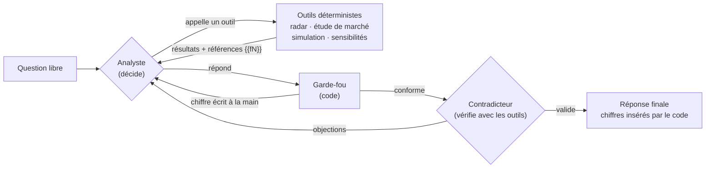
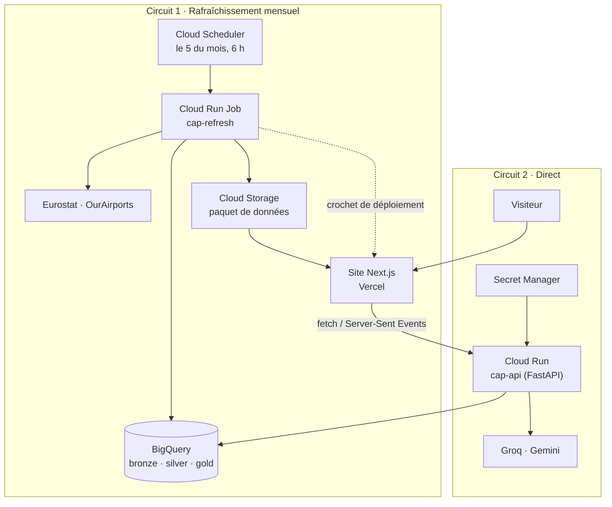

<div align="center">

# ✈️ CAP · Network Planning Copilot

**Faut-il ouvrir une nouvelle ligne au départ de Paris CDG ?**
**CAP détecte les opportunités, instruit le dossier et répond aux questions de l'équipe réseau, chiffres sourcés à l'appui.**

[](https://cap-network.vercel.app)
[](#-architecture)
[](#-architecture)


[Démo](https://cap-network.vercel.app) · [Fonctionnalités](#-ce-que-fait-cap) · [Architecture](#-architecture) · [Démarrage rapide](#-démarrage-rapide) · [Déploiement](DEPLOIEMENT.md)

</div>

---

## 📌 En bref

Ouvrir une ligne long-courrier engage des dizaines de millions d'euros par an. Avant de décider, un analyste réseau doit réunir le trafic existant, la concurrence, une estimation de recette et de coûts, puis défendre son dossier. **Ce travail prend des jours.**

CAP le fait en quelques secondes, sur des **données publiques officielles** (Eurostat), avec un **modèle économique dont chaque hypothèse est sourcée**, et une règle non négociable :

> 🔒 **L'intelligence artificielle raisonne et rédige. Le code calcule.**
> Aucun chiffre affiché n'est écrit par l'IA : elle cite des références renvoyées par les outils, et le programme insère les valeurs calculées. Un garde-fou rejette automatiquement tout texte contenant un chiffre écrit à la main.

<table>
<tr>
<td align="center"><b>1 439 824</b><br/><sub>lignes de trafic chargées</sub></td>
<td align="center"><b>182</b><br/><sub>destinations au radar</sub></td>
<td align="center"><b>79</b><br/><sub>dossiers long-courrier</sub></td>
<td align="center"><b>467</b><br/><sub>études de marché</sub></td>
<td align="center"><b>≈ 4 s</b><br/><sub>par dossier</sub></td>
<td align="center"><b>0</b><br/><sub>chiffre écrit par l'IA</sub></td>
</tr>
</table>

---

## 🧭 Sommaire

- [Ce que fait CAP](#-ce-que-fait-cap)
- [Chaîne d'instruction et agents IA](#-chaîne-dinstruction-et-agents-ia)
- [Le garde-fou](#-le-garde-fou)
- [Architecture](#-architecture)
- [Les données](#-les-données)
- [Le modèle économique](#-le-modèle-économique)
- [Stack technique](#-stack-technique)
- [Structure du dépôt](#-structure-du-dépôt)
- [Démarrage rapide](#-démarrage-rapide)
- [API](#-api)
- [Tests](#-tests)
- [Limites connues](#-limites-connues)
- [Feuille de route](#-feuille-de-route)

---

## 🎯 Ce que fait CAP

| | Usage | Ce que l'on obtient |
|---|---|---|
| 📡 | **Détecter** · le radar | Les destinations desservies régulièrement par 16 grands hubs européens (Amsterdam, Francfort, Istanbul, Madrid…) mais **pas par Paris**, classées par un score transparent. |
| 🔎 | **Étudier** · le marché | Pour **n'importe quelle destination**, desservie ou non : trafic de Paris face aux hubs, part et rang de Paris, évolution mois par mois depuis 2019, remplissage, santé de la ligne, simulation de rentabilité. |
| 📁 | **Instruire** · le dossier | Pour chaque destination long-courrier du radar : marché, concurrence, compte de résultat, objections, recommandation, avec un simulateur pour modifier les hypothèses. |
| 🤖 | **Questionner** · les agents IA | Une question libre (*« Avec un seul A350, Manille, Jakarta ou Kuala Lumpur ? »*). L'Analyste choisit ses outils et creuse ; le Contradicteur conteste ; tout le raisonnement s'affiche en direct. |
| 🛠️ | **Montrer** · sous le capot | L'inventaire réel de BigQuery, le SQL exécuté, le journal du rafraîchissement mensuel et un test de l'API en direct. |

---

## 🧠 Chaîne d'instruction et agents IA

CAP utilise **deux mécanismes différents, chacun à sa place**.

| | 📁 Chaîne d'instruction | 🤖 Agents IA |
|---|---|---|
| **Sert à** | Produire les dossiers d'ouverture | Répondre aux questions ouvertes |
| **Nature** | Workflow déterministe (LangGraph) | Agents à appel d'outils |
| **Parcours** | Fixe, six étapes | Choisi par l'IA à chaque tour |
| **Rôle de l'IA** | Rédiger la note | Choisir les outils, raisonner, rédiger, contester |
| **Reproductible** | Oui, à l'identique | Non, mais chaque chiffre est tracé |
| **Garde-fou** | ✅ | ✅ |

> **Pourquoi deux mécanismes ?** Un business plan doit donner le même résultat à chaque fois : il suit une chaîne fixe. Une question ouverte demande d'explorer : le chemin dépend de ce qu'on découvre.

### 📁 La chaîne d'instruction (six étapes)

```text
Éclaireur ─▶ Marché ─▶ Concurrence ─▶ Économiste ─▶ Avocat du diable ─▶ Rédacteur
 (radar)     (hubs)    (Paris→hubs)   (modèle)      (règles d'alerte)    (IA + garde-fou)
```

Chaque étape interroge BigQuery avec une requête paramétrée écrite à l'avance, produit ses faits, et laisse une trace complète : texte SQL, octets lus, durée, faits produits, brouillons de l'IA, rejets du garde-fou.

### 🤖 Les agents IA : l'Analyste et le Contradicteur



- **Ce sont de vrais agents** : à chaque tour, le modèle de langage décide seul d'appeler un outil (lequel, avec quels paramètres) ou de répondre. Une ligne déficitaire le pousse à tester un autre appareil, une demande concentrée à comparer une autre destination.
- **Les outils restent déterministes** : requêtes BigQuery paramétrées et modèle économique. L'IA n'écrit jamais de SQL.
- **Résilience** : Groq (`gpt-oss-120b`) en premier, Gemini puis Groq `gpt-oss-20b` en relais, attente automatique en cas de saturation, réponse de secours si le garde-fou n'est jamais satisfait.

---

## 🔒 Le garde-fou

Une IA de langage peut inventer un chiffre avec aplomb. Dans un dossier qui engage des millions d'euros, c'est inacceptable. CAP l'empêche **par construction** :

1. **Chaque chiffre renvoyé par un outil reçoit une référence** (`{{f1}}`, `{{f2}}`…). L'IA voit la valeur pour raisonner.
2. **L'IA ne cite que des références.** Exemple : *« le résultat atteint {{f12}} pour une marge de {{f13}} »*.
3. **Le code contrôle** : tout chiffre écrit à la main, toute référence inventée ou section manquante entraîne un rejet motivé, et l'IA réécrit.
4. **Le code insère les valeurs** calculées, et la réponse liste chaque chiffre cité avec l'outil qui l'a produit.

> Testé avec une IA volontairement menteuse : ses chiffres inventés n'atteignent jamais le texte final.

---

## 🏗️ Architecture



- **Une seule image Docker** sert à l'API (service Cloud Run) et au rafraîchissement mensuel (job Cloud Run).
- **Toujours une réponse** : si l'API ne répond pas, le site bascule automatiquement sur les données exportées du dernier rafraîchissement.
- **Sécurité** : compte de service à privilèges minimaux, clés d'IA dans Secret Manager, limite de 8 demandes par visiteur et par 10 minutes, 2 instances au plus.

---

## 🗄️ Les données

Architecture **médaillon** dans Google BigQuery :

| Couche | Contenu | Volume |
|---|---|---|
| 🥉 **Bronze** | Copie fidèle des sources : trafic Eurostat (passagers, sièges, vols par paire d'aéroports et par mois, 33 pays déclarants, depuis 2019), référentiel OurAirports, corrections de l'analyste | 1 439 824 lignes |
| 🥈 **Silver** | Une ligne par route et par mois, villes et distances ajoutées, qualité étiquetée (`ok`, `valeur_masquee`, aéroport inconnu…), fraîcheur par pays | 481 660 routes-mois |
| 🥇 **Gold** | Fenêtres glissantes de 12 mois, santé des lignes CDG, radar d'opportunités | 182 destinations |

**Principes appliqués**

- *Une donnée absente n'est pas une donnée nulle* : les volumes masqués par Eurostat sont conservés et signalés (c'est ce qui a éliminé les faux positifs Dubaï et Atlanta).
- *La fraîcheur se mesure* : chaque pays est analysé sur ses 12 derniers mois publiés, jamais sur une année fixe.
- *Le jugement de l'analyste est tracé* : chaque correction manuelle exige une source et une date.

**Score du radar** (rang centile à l'intérieur de chaque segment)

| Critère | Poids |
|---|---|
| Volume de passagers des hubs vers la destination | 40 % |
| Croissance sur un an | 25 % |
| Remplissage des vols existants | 20 % |
| Nombre de hubs qui desservent la destination | 15 % |

---

## 💶 Le modèle économique

Volontairement lisible : on peut le refaire à la main.

```text
vols        = 2 × fréquences hebdomadaires × semaines
passagers   = vols × sièges × remplissage
recette     = passagers-km × recette par passager-km
coûts       = sièges-km × coût par siège-km   (dont carburant)
résultat    = recette − coûts
```

Hypothèses issues du **communiqué annuel 2025 d'Air France-KLM**, page citée. Le modèle refuse de démarrer si une hypothèse n'a pas de source.

| Hypothèse | Valeur |
|---|---|
| Recette par passager-km | 9,75 c€ |
| Coût par siège-km | 8,10 c€ |
| dont carburant | 1,99 c€ |
| Remplissage moyen | 87,9 % (ajusté par région) |
| Appareils | A350-900 (324 sièges), B787-9 (279), B777-300ER (312), B777-200ER (328) |

Le simulateur du site recalcule dans le navigateur avec **exactement les mêmes formules** que le modèle Python.

---

## 🧰 Stack technique

| Domaine | Outils |
|---|---|
| **Sources** | Eurostat (API SDMX 2.1, réponses asynchrones), OurAirports, communiqué Air France-KLM 2025 |
| **Données** | Python, pandas, pyarrow, Google BigQuery, SQL |
| **IA** | LangGraph (chaîne d'instruction), agents à appel d'outils (format OpenAI), Groq `gpt-oss-120b`, Gemini, garde-fou maison |
| **API** | FastAPI, Server-Sent Events, Uvicorn |
| **Cloud** | Cloud Run (service et job), Cloud Scheduler, Cloud Storage, Secret Manager, Artifact Registry, Cloud Build |
| **Site** | Next.js 15, React 19, TypeScript, react-markdown, carte SVG générée depuis Natural Earth (world-atlas, d3-geo) |
| **Qualité** | pytest (44 tests), IA simulée pour tester la boucle des agents sans appel réseau |
| **Hébergement** | Vercel (site), GitHub (code) |

---

## 📂 Structure du dépôt

```text
cap/
├── ingestion/            # Bronze : Eurostat, OurAirports, corrections de l'analyste
├── transform/sql/        # Silver et gold, en SQL BigQuery
├── reference/            # Hypothèses sourcées, corrections, instantané de secours
├── economics/            # Modèle économique et sensibilités
├── agents/
│   ├── datasource.py     # Seule couche d'accès aux données (BigQuery ou instantané), trace chaque requête
│   ├── graph.py          # Chaîne d'instruction en six étapes (LangGraph)
│   ├── tools.py          # Outils déterministes des agents, registre des références {{fN}}
│   ├── analyst.py        # Agents IA : Analyste et Contradicteur
│   ├── toolchat.py       # Client LLM à appel d'outils, relais Groq → Gemini
│   ├── guard.py          # Garde-fou
│   ├── market.py         # Étude de marché d'une destination
│   ├── batch.py          # Génération des dossiers
│   ├── export_market.py  # Export des études (mode secours du site)
│   └── record_examples.py# Sessions enregistrées des agents (mode « Rejouer »)
├── api/main.py           # API FastAPI (Cloud Run)
├── pipeline/refresh.py   # Rafraîchissement mensuel complet
├── ops/                  # Inventaire GCP, retrait de l'expiration des tables
├── tests/                # 44 tests
├── site/                 # Site Next.js (Vercel)
├── Dockerfile
└── DEPLOIEMENT.md        # Déploiement pas à pas sur Google Cloud et Vercel
```

---

## 🚀 Démarrage rapide

### Prérequis

- Python 3.12, Node.js 20 ou plus
- Un projet Google Cloud avec BigQuery, et `gcloud` authentifié
- Des clés API [Groq](https://console.groq.com) et/ou [Gemini](https://aistudio.google.com) (facultatives : sans clé, CAP fonctionne avec ses gabarits de secours)

### 1. Installer

```bash
git clone https://github.com/heykelh/cap.git
cd cap
python -m venv .venv
# Windows : .venv\Scripts\activate    ·    macOS / Linux : source .venv/bin/activate
pip install -r requirements.txt
```

Créer un fichier `.env` à la racine :

```env
GCP_PROJECT_ID=votre-projet
BQ_LOCATION=EU
GROQ_API_KEY=...
GEMINI_API_KEY=...
```

### 2. Construire l'entrepôt

```bash
python ingestion/eurostat_bronze.py
python ingestion/ourairports_bronze.py
python ingestion/reference_bronze.py
python transform/run_sql.py silver
python transform/run_sql.py gold
```

Ou tout d'un coup : `python -m pipeline.refresh --no-publish`.

### 3. Générer les données du site

```bash
python -m agents.batch --llm groq,gemini      # dossiers long-courrier
python -m agents.export_market                # études de marché
python -m agents.record_examples              # sessions des agents IA
python -m ops.gcp_inventory                   # inventaire BigQuery
```

### 4. Lancer l'API et le site

```bash
uvicorn api.main:app --port 8080
```

Dans un second terminal :

```bash
cd site
echo NEXT_PUBLIC_CAP_API=http://localhost:8080 > .env.local
npm install
npm run dev
```

Ouvrir [http://localhost:3000](http://localhost:3000).

> 💡 Sans BigQuery, l'API peut tourner sur l'instantané : `CAP_SOURCE=snapshot uvicorn api.main:app --port 8080`.

---

## 🔌 API

| Point d'entrée | Description |
|---|---|
| `GET /health?bigquery=1` | État du service et aller-retour BigQuery (identifiant du job) |
| `GET /marche/{iata}` | Étude de marché en direct, avec les requêtes exécutées et leur coût |
| `GET /instruire?dest=MNL` | Chaîne d'instruction en direct, étape par étape (SSE) |
| `GET /analyste?question=...` | Agents IA en direct : décisions, appels d'outils, garde-fou, verdict, réponse (SSE) |

Exemple :

```bash
curl "https://<cap-api>.run.app/marche/JFK"
```

---

## ✅ Tests

```bash
python -m pytest -q
```

Les 44 tests couvrent notamment :

- les formules du modèle économique et leur cohérence ;
- le garde-fou face à une IA qui invente des chiffres ;
- la boucle complète des agents avec une IA simulée : appels d'outils, rejet, objection du Contradicteur, nouvelle réponse ;
- le relais entre fournisseurs d'IA en cas de saturation ;
- l'étude de marché (part de Paris, volumes masqués jamais comblés).

---

## ⚠️ Limites connues

CAP dit ce qu'il ne sait pas.

- **Demande réelle** : la demande de bout en bout (combien de Parisiens veulent aller à Manille) n'est pas publique. CAP l'approche par le trafic des hubs concurrents.
- **Recette** : la recette moyenne du réseau est appliquée à toutes les lignes ; elle surestime probablement les lignes très longues. C'est pourquoi la plupart des dossiers concluent « approfondir avant décision ».
- **Fraîcheur** : Eurostat publie avec plusieurs mois de décalage selon les pays (France : jusqu'à décembre 2024).
- **Concurrence** : CAP voit les aéroports, pas les compagnies.
- **Agents IA** : leurs réponses varient d'une exécution à l'autre ; les chiffres, eux, sont toujours ceux des outils.

> **Branchable sur des données internes** : toute la lecture passe par une seule couche d'accès (`agents/datasource.py`). Dans une compagnie, on la pointe vers ses propres tables (réservations, programme de vols, coûts réels) sans toucher à la chaîne, aux agents, au modèle ni au site.

---

## 🗺️ Feuille de route

- [x] Entrepôt BigQuery bronze, silver, gold
- [x] Radar d'opportunités et santé des lignes CDG
- [x] Modèle économique sourcé et simulateur
- [x] Chaîne d'instruction avec garde-fou
- [x] Agents IA à appel d'outils (Analyste, Contradicteur)
- [x] API Cloud Run et rafraîchissement mensuel automatique
- [ ] Recette par région au lieu de la moyenne du réseau
- [ ] Prise en compte de la flotte disponible dans les arbitrages
- [ ] Données de demande de bout en bout (sources commerciales ou internes)

---

## 👤 Auteur

**Heykel Hachiche** · Data Engineer & AI Engineer

[](https://github.com/heykelh)
[](https://heykelhachiche.com)

---

<sub>Projet indépendant, conçu comme démonstration pour une équipe de planification réseau. Il n'est ni affilié à Air France ni validé par la compagnie. Données publiques : Eurostat, OurAirports, communiqué annuel Air France-KLM 2025.</sub>
